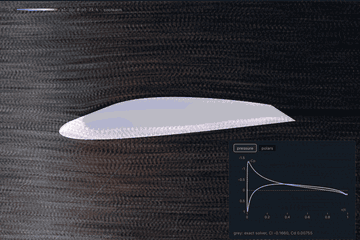
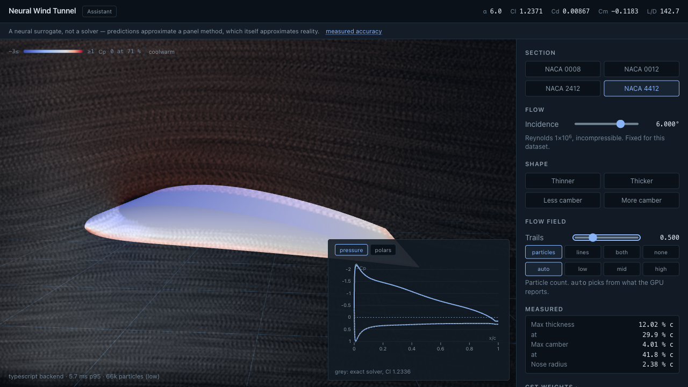
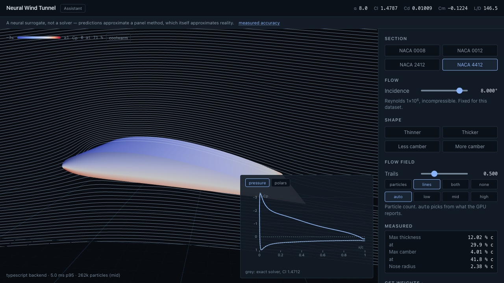
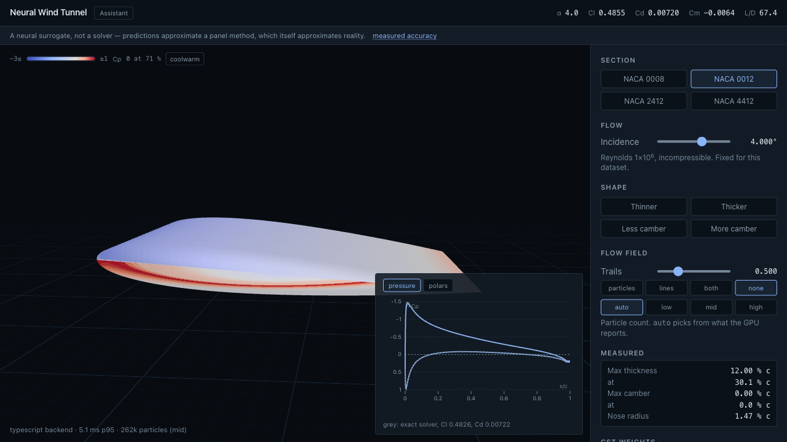
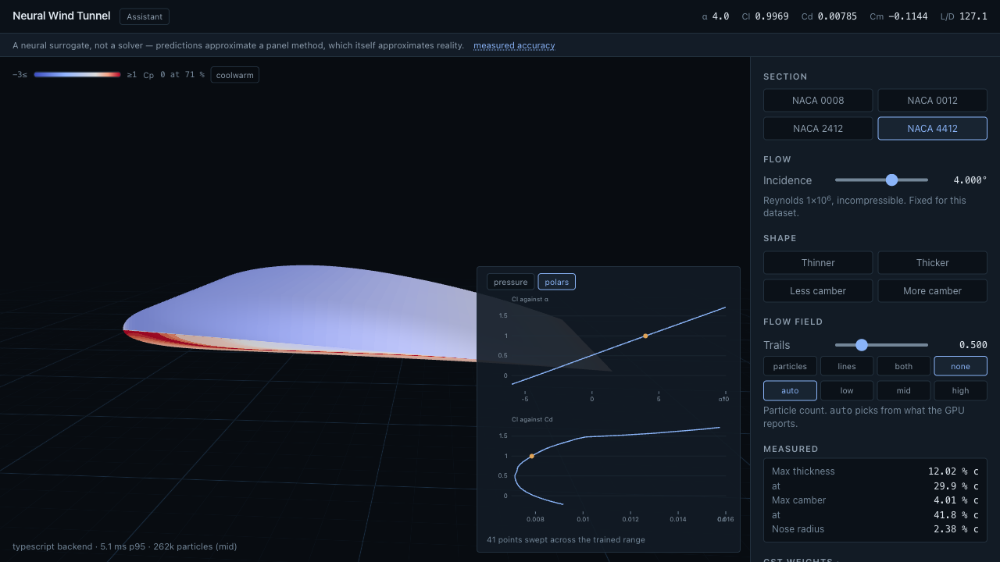
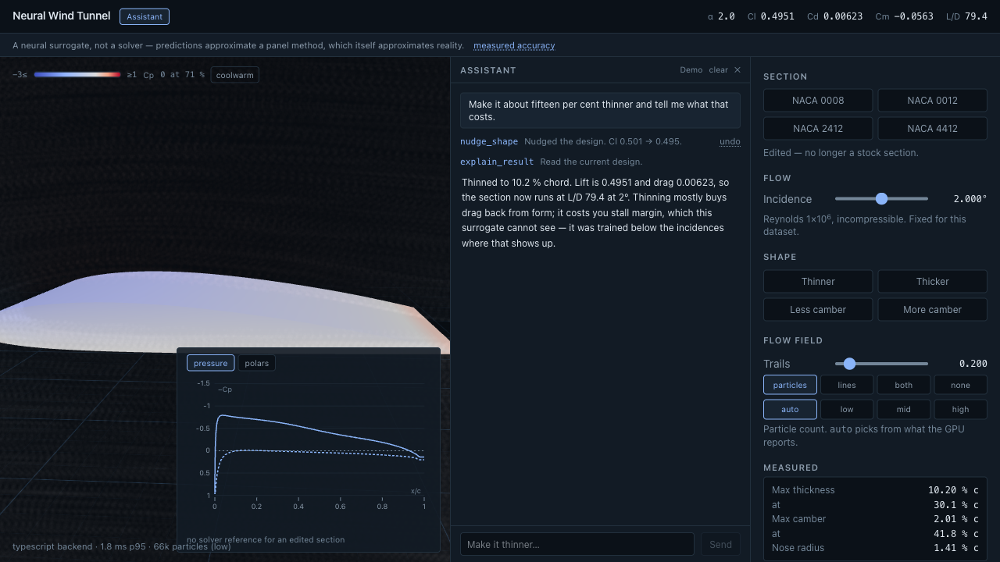
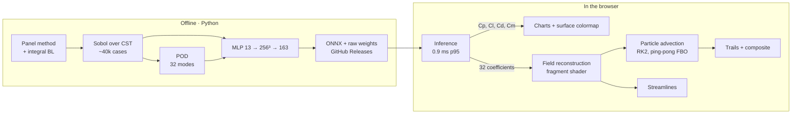

# Neural Wind Tunnel

[](https://github.com/jaworskig00/neural-wind-tunnel/actions/workflows/ci.yml)
[](LICENSE)

Shape an aerofoil in the browser and watch the flow answer. A neural surrogate, trained on a
panel-method solver that lives in this repository, predicts the surface pressure, the force
coefficients and a reduced-order representation of the velocity field in under a millisecond — on
every slider movement. The GPU reconstructs that field and advects a million particles through it.



**Live demo:** not deployed yet · **Accuracy:** [`docs/accuracy.md`](docs/accuracy.md) ·
**Performance:** [`docs/perf.md`](docs/perf.md) · **Decisions:**
[`docs/DECISIONS.md`](docs/DECISIONS.md)

## The claim, and what backs it

The particles are not noise dressed up as flow. They follow a velocity field reconstructed as
`mean + Σ aᵢ·φᵢ` from coefficients the network predicted — a reduced-order model, which is what
production simulation tools use when a full solve is too slow to be interactive. The field comes
from the model or it does not appear at all; there is no procedural fallback anywhere in the
codebase.

That claim is only worth making if the error is stated, so it is, in numbers:

| What                                 | Against                                  | Measured                             |
| ------------------------------------ | ---------------------------------------- | ------------------------------------ |
| Surrogate lift coefficient           | This project's solver                    | 0.0095 mean absolute error, R² 0.996 |
| Surrogate drag coefficient           | This project's solver                    | 0.0002 mean absolute error, R² 0.969 |
| Surrogate pressure, all 128 stations | This project's solver                    | 0.055 rms                            |
| The solver's lift slope              | Thickness-corrected thin-aerofoil theory | Within 1.2 %                         |
| The solver's drag                    | Published NACA 0012 data                 | 3–10 % high                          |
| The solver's quarter-chord moment    | Published NACA 4412 data                 | Up to 19 % too nose-down             |

**The two stack.** A drag number on screen carries the surrogate's error on top of the solver's.
[`docs/accuracy.md`](docs/accuracy.md) breaks the first down per output and per incidence;
[`docs/solver-validation.md`](docs/solver-validation.md) does the same for the second, including
the cases where the integral boundary layer simply fails to converge and the app shows no drag at
all rather than a plausible one.

## What you can do with it

**Shape it.** Four NACA presets, two transforms that matter — thickness and camber, which are
separable in CST weight space — and, underneath, the twelve raw Bernstein weights. Every control
is bounded by the dataset's own sampling range, so the surrogate is never asked to extrapolate.

**Watch it.** A pressure colormap on the surface, a GPGPU particle field with trails, streamlines
integrated through the same field, and a pressure plot that overlays the exact solver wherever a
reference exists for the section on screen.

<p align="center">
  
  
</p>

**Read it.** The pressure distribution with the axis inverted the way an aerodynamicist expects,
and the polars — lift against incidence, lift against drag — swept across the trained range off
the critical path while you keep dragging.

<p align="center">
  
  
</p>

**Ask it.** An optional assistant turns "make it fifteen per cent thinner and tell me what that
costs" into tool calls against the same surrogate, shows every call it made, and offers an undo
next to each one. It needs no API key to try: three recorded conversations ship with the app, and
their tool calls run for real against whatever section you have on screen.



**Share it.** The whole design lives in the URL. A link reopens the exact section, incidence,
view and camera — and says so if it had to clamp anything.

## How it works



### The solver

[`tools/solver`](tools/solver) is a linear-strength vortex panel method with the Kutta condition
for the inviscid part, and an integral boundary layer for the viscous part: Thwaites while laminar,
Michel's criterion for transition, Head's entrainment method when turbulent, Ludwieg-Tillmann for
skin friction and Squire-Young to carry the momentum thickness to infinity. It is a textbook
method, and it is validated against published data rather than against itself.

It also knows when it has failed. Three separate guards — a trailing-edge cutoff, a suction-peak
floor, a bound on momentum thickness — mark a case invalid instead of emitting a number, and the
dataset build asserts every published row is physically plausible before it writes a file. All
three exist because something non-physical reached the dataset and looked exactly like data;
ADR-018 through ADR-020 are the post-mortems.

### The surrogate

Thirteen inputs — twelve CST weights and the incidence — through three layers of 256 to 163
outputs: 128 pressure stations, three force and moment coefficients, and 32 modal coefficients.
About 0.7 MB in fp32, trained with a Huber loss because squared error optimised the comfortable
99 % of rows while the extreme one per cent got steadily worse.

It ships twice. ONNX Runtime Web is the recognisable answer and is available at the flip of a
query parameter; the default is a hand-written forward pass in TypeScript, because thirteen inputs
through three small layers is thirty microseconds of arithmetic and the runtime costs 109 kB of
WebAssembly to do the same thing slower. Both are tested for numerical parity. ADR-021 records the
measurement that reversed the original decision.

### The field

The velocity fields are not learned pixel by pixel — 192 × 96 × 2 outputs per case would be a far
larger network predicting something far smoother than itself. Proper orthogonal decomposition
reduces the whole dataset of fields to a mean plus 32 modes carrying 99 % of the energy, and the
network predicts only the coefficients. The browser reconstructs the field in one fragment-shader
pass over a texture atlas of the modes.

### The shaders

Hand-written GLSL on WebGL2, no post-processing library:

| Pass                 | Runs when              | What it does                                                  |
| -------------------- | ---------------------- | ------------------------------------------------------------- |
| Field reconstruction | The prediction changes | 33 texture fetches per texel into a float render target       |
| Body mask            | The shape changes      | The section into a mask the particles cannot enter            |
| Particle advection   | Every frame            | RK2 against ping-pong position textures, respawn at the inlet |
| Trail fade and draw  | Every frame            | Additive points into an accumulation buffer that decays       |
| Composite            | Every frame            | Tone-mapped over the scene, `1 - exp(-x·I)`                   |

A capability probe runs before the first frame and a frame-time probe adjusts afterwards, so the
particle count matches the hardware: 65k, 262k or 1 048 576. On an M4 Pro every tier is
vsync-bound at 8.3 ms, which is the honest way of saying the GPU work is too small to measure
against a 120 Hz refresh. [`docs/perf.md`](docs/perf.md) has the method and the numbers.

## Honest limits

The app says this on first load, not in a footnote.

- Two-dimensional, incompressible, Reynolds number fixed at one million.
- No stall, no separation modelling, no compressibility, no three-dimensional effects. The
  trained range stops at +10° for exactly this reason.
- Drag is the least reliable output and is missing where the viscous march did not converge —
  which is most often at the top of the incidence range.
- The reference solver is itself an approximation, and its own errors are documented.
- The assistant quotes only numbers that came from a tool call you can see. It is still a language
  model, and the aerodynamic reasoning around those numbers is its own.

## Accessibility

Every control is a native element and works from the keyboard; focus is visible; the charts carry
text alternatives; the palette is checked at AA against both surfaces it sits on. Reduced motion
is honoured by pausing the particles and drawing the field as streamlines instead — the same
field, standing still — with an override for anyone who wants it to move anyway.
[`docs/accessibility.md`](docs/accessibility.md) says what is covered and what is not.

## Running locally

```bash
pnpm install
pnpm models:sync   # fetches the published model and mode atlas from Releases
pnpm dev
```

No API key is needed for anything except the assistant's live mode, and the assistant works
without one. A key you paste is stored only in your browser's local storage and sent directly to
the provider you chose; this project has no server to send it to.

Regenerating the dataset and the model needs the Python toolchain. The full run is about
half an hour on twelve cores, and `--help` on each command explains the knobs:

```bash
uv sync
uv run python -m tools.dataset.run       # solve ~40k cases into parquet shards
uv run python -m tools.dataset.pod       # 32-mode POD basis
uv run python -m tools.dataset.build     # assemble, validate, publish
uv run python -m tools.train.train       # train
uv run python -m tools.train.export      # ONNX + raw weights + manifest
uv run python -m tools.train.accuracy    # regenerate docs/accuracy.md
```

Checks, all of which CI runs on every push:

```bash
pnpm lint && pnpm typecheck && pnpm test && pnpm build && pnpm size && pnpm check:bundle
pnpm test:e2e
uv run ruff check . && uv run pytest
```

## Sister project

[**design-space-explorer**](https://jaworskig00.github.io/design-space-explorer/)
([source](https://github.com/jaworskig00/design-space-explorer)) — a D3 explorer for thousands of
design variants, built in parallel with this project.

The two were planned to share a dataset and a deep link, and neither happened. The explorer
generates its own sample from a different parametrisation — camber, camber position, thickness,
incidence and Reynolds number, sampled continuously — and its ADR-002 records the decision not to
consume this project's CST dataset. There is no button in it that opens a design here.

The contract for that link exists on this side and is unused:
[`docs/URL-STATE.md`](docs/URL-STATE.md) is a complete, versioned deep-link format, and
[`docs/DATASET-SCHEMA.md`](docs/DATASET-SCHEMA.md) describes the dataset. Connecting the two would
need three things that do not exist yet: a deployed URL to link to, a mapping from the explorer's
`(camber, position, thickness)` onto twelve CST weights, and an honest answer for Reynolds number,
which is a dimension there and fixed at 1e6 here. The two repositories share no code.

## Repository map

| Path             | Contents                                                                       |
| ---------------- | ------------------------------------------------------------------------------ |
| `tools/solver/`  | Panel method, boundary layer, geometry, field evaluation                       |
| `tools/dataset/` | Sobol sampling, parallel solve, POD, build and validation                      |
| `tools/train/`   | Training, export, accuracy report, artifact check                              |
| `src/geometry/`  | CST parametrisation, presets, shape operations                                 |
| `src/ml/`        | Two backends behind one interface, plus the parity test                        |
| `src/rom/`       | Mode atlas, field reconstruction, streamline integration, capability detection |
| `src/gpgpu/`     | Ping-pong targets, particles, trails, body mask, frame probe                   |
| `src/shaders/`   | Hand-written GLSL                                                              |
| `src/llm/`       | Tool schemas, dispatcher, provider adapters, recorded demos                    |
| `docs/`          | Plan, decision records, data contracts, accuracy, performance, accessibility   |
| `data/sample/`   | A committed slice of the dataset, for tests and for the sister project         |

## Licence

Code under [MIT](LICENSE). The generated dataset is published under CC BY 4.0.
