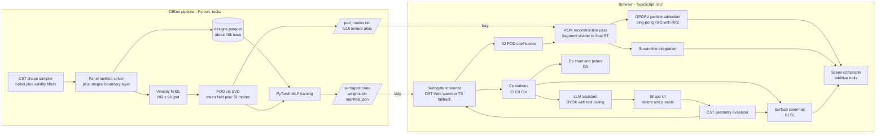

# Neural Wind Tunnel — master plan

A browser wind tunnel: parametric airfoil in, instant neural-surrogate flow prediction out,
rendered as a GPU particle field with a pressure colormap and live engineering charts.

This document is the single source of truth for execution. Work through it milestone by
milestone, task by task, in order. Tick the checkboxes as tasks land.
Conventions, commands and autonomous-mode rules live in [`../AGENTS.md`](../AGENTS.md).
Decision records live in [`DECISIONS.md`](DECISIONS.md).

---

## 0. Before you start autonomous mode (preflight)

The agent verifies this itself before task T0.2 and logs the result in
[`PROGRESS.md`](PROGRESS.md). If a check fails and no sensible default fixes it, record it in
[`QUESTIONS.md`](QUESTIONS.md) and continue with the next independent task.

- [x] `gh auth status` reports an authenticated account with `repo` scope
- [x] `git config user.name` and `git config user.email` are set
- [x] `git remote -v` points at the GitHub repo and `git push` works
- [x] Node matches `.nvmrc` (25.x) and `pnpm --version` is 10.x
- [x] `python3 --version` is 3.12+ and `uv --version` works
- [x] `pnpm exec playwright install chromium` succeeds
- [x] A WebGL2 context with `EXT_color_buffer_float` is available in headless Chromium
      (if not: M6 tasks run with the half-float fallback path and this is noted in `docs/perf.md`)

Nothing in this plan requires a paid service, an API key or a human decision.

---

## 1. Goals

1. **Prove Three.js and GLSL depth.** Hand-written GPGPU particle advection, a reduced-order
   reconstruction pass, a pressure colormap material and streamline integration — not a
   library demo.
2. **Prove 3D + ML integration.** A real surrogate model trained on a real solver, exported to
   ONNX, running in the browser in single-digit milliseconds.
3. **Prove honest engineering.** Documented accuracy against the reference solver, explicit
   limits, reproducible data pipeline.
4. **Impress in 30 seconds.** Open the demo, drag a slider, watch the flow field change
   instantly.

### Non-goals

- A real CFD solver in the browser. This is a surrogate, and the UI says so.
- Turbulence, compressibility, separation modelling, 3D wings (v1).
- Accounts, persistence, telemetry, monetisation.
- A deployment pipeline (M10 placeholder; the app stays static-friendly throughout).

### Target users

Engineers and hiring managers at simulation, aerospace, CAD and AI-physics companies. They
will skim the live demo first and the source second. Both must hold up.

### Success criteria for the demo

| Criterion                                      | Target                                       |
| ---------------------------------------------- | -------------------------------------------- |
| Time from page load to interactive flow        | < 3 s on a cable connection                  |
| Latency from slider drag to updated field      | < 50 ms end to end                           |
| Frame rate, 500k particles, 1440x900, Apple M1 | 60 fps sustained                             |
| Accuracy claim on screen                       | Backed by `docs/accuracy.md`, not adjectives |
| Works with no API key                          | Fully, including a recorded LLM demo mode    |

---

## 2. Architecture



### The idea that makes this honest

The surrogate does **not** predict a velocity field pixel by pixel, and the particles are
**not** driven by noise. The offline pipeline runs proper orthogonal decomposition on the
solver's velocity fields and keeps the mean field plus 32 modes. The network predicts the 32
modal coefficients; the GPU reconstructs the field as `mean + sum(a_i * phi_i)` in one
fragment-shader pass. That is a reduced-order model — the same technique production
simulation tools use — so every particle follows an approximation of a real solution, and the
approximation error is measurable and documented.

### Folder structure

```
tools/            Python: solver, dataset pipeline, training, export
  solver/         geometry (CST, NACA), panel method, boundary layer, field sampling
  dataset/        sampling, batch runner, POD, manifest
  train/          model, training loop, export, accuracy report
src/              TypeScript app
  app/            shell, layout, routing of panels, theming
  state/          zustand store, URL state codec
  geometry/       CST evaluator, airfoil mesh builder, SDF
  ml/             surrogate backends (ORT Web, TS), shared interface
  rom/            POD atlas loader, reconstruction pass
  gpgpu/          particle system, ping-pong targets, advection
  scene/          R3F components, materials, composite
  shaders/        .glsl modules with a documented include convention
  charts/         D3 Cp plot, polars
  llm/            provider adapters, tool schema, dispatcher, demo transcripts
docs/             this plan, decisions, contracts, accuracy, perf, screenshots
data/sample/      small committed CSV sample of the dataset
models/           generated artifacts, gitignored, fetched from Releases
tests/e2e         Playwright specs; unit tests sit next to the module they cover
```

### Data contracts shared with the sister project

The sister repo **design-space-explorer** (D3 design-space explorer, built in parallel)
consumes this project's dataset. Two documents are the contract and must not drift:

- [`DATASET-SCHEMA.md`](DATASET-SCHEMA.md) — columns, units, conventions, file layout, versioning
- [`URL-STATE.md`](URL-STATE.md) — the deep-link format, so the explorer can open a selected design here

Neither repo blocks the other. `tools/stub_dataset.py` generates schema-conformant placeholder
data so the explorer can be built before this project's M2 lands.

---

## 3. Tech stack

| Choice                    | Why                                                                                                              |
| ------------------------- | ---------------------------------------------------------------------------------------------------------------- |
| TypeScript strict         | Non-negotiable for a code sample.                                                                                |
| Vite                      | Fast, static output, first-class WASM and worker support.                                                        |
| React + react-three-fiber | Declarative scene graph that composes with the UI; the interesting code stays in plain GLSL and raw WebGL calls. |
| Hand-written GLSL, WebGL2 | Universal support and the shaders are the point. WebGPU is a later, additive path.                               |
| zustand                   | Minimal store, no boilerplate, easy to serialise into the URL.                                                   |
| Tailwind v4               | Fast, consistent chrome without a component library.                                                             |
| D3                        | Idiomatic engineering charts, and it mirrors the sister project.                                                 |
| Vitest + Playwright       | Unit tests where logic is real, screenshots where the output is visual.                                          |
| Python 3.12 + uv + NumPy  | The solver is linear algebra; uv keeps the env reproducible in CI.                                               |
| PyTorch to ONNX           | Standard export path; ONNX is the canonical artifact.                                                            |
| onnxruntime-web, wasm     | Runs everywhere, lazy-loaded off the critical path.                                                              |
| Raw-weights TS fallback   | Proves the model is understood, keeps a working path if ORT fails, and gives a numerical parity test.            |

### Performance budgets

Enforced in `docs/perf.md` and, where cheap, in CI.

| Budget                          | Limit                                                  |
| ------------------------------- | ------------------------------------------------------ |
| Initial JS bundle               | 250 kB gzip, excluding lazy ORT wasm and the POD atlas |
| Surrogate inference, p95        | 5 ms                                                   |
| ROM reconstruction pass         | 2 ms                                                   |
| Geometry rebuild on slider drag | 16 ms                                                  |
| Particles at 60 fps, Apple M1   | 500k                                                   |
| Model artifact                  | 1 MB                                                   |
| POD mode atlas                  | 3 MB                                                   |
| Lighthouse performance, desktop | 90                                                     |

---

## 4. Milestones

Each task is sized for one agent session. Every task ends with: checks green, conventional
commit, push, checkbox ticked here, entry appended to [`PROGRESS.md`](PROGRESS.md).

### M0 — Repository, tooling, CI

- [x] **T0.1** Repo created, MIT licence, `.gitignore`, `.editorconfig`, `.nvmrc`, planning docs committed and pushed.
- [x] **T0.2** Vite + React + TS strict scaffold; `package.json` scripts `dev build preview lint typecheck test test:e2e format`; app renders a placeholder shell.
- [x] **T0.3** ESLint flat config + Prettier + lint-staged + git hook; `pnpm lint` clean on a bare repo.
- [x] **T0.4** Vitest configured with a coverage reporter and one real test (CST evaluator fixture placeholder is fine).
- [x] **T0.5** Playwright configured; smoke test asserts the app boots with zero console errors and zero failed requests.
- [x] **T0.6** Python env via `uv`: `pyproject.toml`, ruff, pytest, `tools/` package layout, one passing test.
- [x] **T0.7** GitHub Actions `ci.yml`: web job (install, lint, typecheck, unit, build, e2e smoke) and python job (ruff, pytest), both cached; `size-limit` check on the bundle budget.
- [x] **T0.8** README skeleton with CI badge; tag `v0.1.0-m0`.

**Acceptance.** `pnpm install && pnpm dev` serves the app; `pnpm lint typecheck test build` all pass; CI is green on `main`; the badge renders.
**Verify.** `gh run list --limit 1` shows success; Playwright smoke artifact exists.

### M1 — Reference solver

- [x] **T1.1** `tools/solver/geometry.py`: NACA 4-digit generator and CST (Kulfan) evaluator per `DATASET-SCHEMA.md`; cosine panel distribution; derived metrics (max thickness and its station, max camber and its station, LE radius, enclosed area). Tests: trailing-edge closure, NACA 0012 thickness within 1e-4, CST round-trip of a fitted NACA 2412 within 1e-3.
- [x] **T1.2** `tools/solver/panel.py`: linear-strength vortex panel method with the Kutta condition; outputs surface Cp, Cl, Cm about quarter chord.
- [x] **T1.3** Inviscid verification against sources with a statable provenance: the exact circle solution `Cp = 1 - 4 sin^2(theta)` with first-order grid convergence; `Cl` slope within 5 % of `2*pi` per radian for NACA 0004; `Cl / sin(alpha)` exactly constant for a symmetric section; zero lift and zero moment at alpha = 0 for a symmetric section within 1e-6; the circulation and pressure-integration lift routes agreeing and converging together. No digitised reference tables are bundled -- see ADR-014.
- [x] **T1.4** `tools/solver/boundary_layer.py`: Thwaites laminar, Michel transition criterion, Head's turbulent method, Squire-Young profile drag; split `cd` into pressure and friction parts; report transition locations; flag non-convergence instead of returning silent garbage.
- [x] **T1.5** `tools/solver/field.py`: evaluate the induced velocity field on the fixed 192 x 96 grid defined in `DATASET-SCHEMA.md`; mask points inside the body; test that far-field velocity tends to the freestream within 1 %.
- [x] **T1.6** `docs/solver-validation.md`: plots and tables versus published NACA data, a plain statement of what the solver cannot do; tag `v0.2.0-m1`.

**Acceptance.** `uv run pytest` green; validation doc contains real numbers and figures; a single call `solve(coords, alpha_deg, reynolds)` returns Cp, Cl, Cd, Cm, transition and the field.
**Verify.** pytest in CI; figures committed under `docs/screenshots/solver/`.

### M2 — Dataset

- [x] **T2.1** `tools/dataset/sample.py`: Sobol sequence over the 12 CST weights plus alpha, within the bounds in `DATASET-SCHEMA.md`; validity filters (thickness 6–20 %, no surface crossing, monotone-enough nose, LE radius bounds); rejection rate reported.
- [x] **T2.2** `tools/dataset/run.py`: multiprocessing batch runner with per-row `solver_status`, resumable checkpoints, parquet writer; failures recorded, never imputed.
- [x] **T2.3** `tools/dataset/pod.py`: POD via truncated SVD on the velocity fields; export mean field plus 32 modes to `.npz` and to the fp16 atlas layout the browser loads; report captured energy per mode count.
- [x] **T2.4** Coverage report (`docs/dataset.md`), `data/sample/designs-sample.csv` with 2000 rows committed, `manifest.json` with bounds, counts, checksums, solver version and data licence.
- [x] **T2.5** Publish the `dataset-v1` GitHub Release with `designs.parquet`, `pod_modes.npz`, `pod_modes.bin`, `cp_stations.json`, `manifest.json`; tag `v0.3.0-m2`.

**Acceptance.** At least 40 000 rows with `solver_status = ok`; the reduced-order basis reconstructs the field to within about 1 % of the freestream away from the section, with the near-surface error published alongside it (ADR-017 replaces the original "99 % of variance at 32 modes", which the full dataset does not meet and which raising the mode count does not usefully fix); the whole dataset regenerates with one command and a documented runtime.
**Verify.** `gh release view dataset-v1` lists the assets; a CI check downloads the sample CSV and validates it against the schema.

### M3 — Surrogate model

- [ ] **T3.1** `tools/train/data.py`: load parquet, standardise inputs and outputs, deterministic train/val/test split by design id so alpha sweeps of one shape never straddle the split.
- [ ] **T3.2** `tools/train/model.py` and `train.py`: MLP 13 to 256 to 256 to 256 to 163 outputs (128 Cp stations, Cl, Cd, Cm, 32 POD coefficients), SiLU, weighted loss so the three scalar coefficients are not drowned by the 128 Cp values; early stopping; fixed seed; normalisation folded into the exported graph.
- [ ] **T3.3** `tools/train/export.py`: export `surrogate.onnx`, raw `weights.bin` plus `manifest.json` for the TS backend, and a `reference_case.json` fixture; assert ONNX and PyTorch agree to 1e-5.
- [ ] **T3.4** `docs/accuracy.md`: RMSE and worst case per output group, error versus alpha, error versus thickness, predicted-against-solver scatter plots, and an explicit "where this model breaks" section.
- [ ] **T3.5** CI job loads the exported artifact and asserts the reference case reproduces within tolerance; tag `v0.4.0-m3`.

**Acceptance.** Model under 1 MB; Cl within 0.02 and Cd within 0.0005 RMSE on the held-out test set, or the real numbers documented honestly if the target is missed; accuracy doc complete.
**Verify.** CI model-load job green; figures committed.

### M4 — Frontend shell and geometry

- [x] **T4.1** App shell: layout with viewport, parameter panel, chart dock, header; light and dark themes; responsive down to tablet width.
- [x] **T4.2** `src/geometry/cst.ts`: TypeScript port of the CST evaluator; parity test against a committed Python-generated fixture within 1e-6.
- [x] **T4.3** R3F scene: extruded airfoil mesh rebuilt from the CST weights, orbit camera with sensible limits, neutral studio lighting, chord-aligned reference grid.
- [x] **T4.4** zustand store plus parameter controls: 12 CST sliders grouped into shape handles, alpha slider, NACA presets (0008, 0012, 2412, 4412; the solver implements the four-digit series only), reset, undo of the last change.
- [x] **T4.5** Playwright screenshot of the default state committed to `docs/screenshots/`; tag `v0.5.0-m4`.

**Acceptance.** Dragging a slider rebuilds the geometry inside the 16 ms budget with no visible tearing; presets load the expected shapes.
**Verify.** Playwright screenshot diff; a performance test asserts the rebuild budget.

### M5 — Browser inference and pressure

- [ ] **T5.1** `src/ml/SurrogateBackend.ts` interface plus the ORT Web backend: lazy dynamic import, wasm with SIMD and threads where available, artifact fetched from the Release URL with a local dev fallback.
- [ ] **T5.2** Pure-TS backend reading `weights.bin`: a few dozen lines of typed matmul plus SiLU, used when ORT fails or is disabled by a query flag.
- [ ] **T5.3** Parity test: ORT, TS backend and the committed Python reference case agree to 1e-4; runs in CI.
- [ ] **T5.4** Cp colormap material in GLSL on the airfoil surface, with a proper legend, a colour-blind-safe option and the sign convention stated.
- [ ] **T5.5** D3 Cp chart with the inverted pressure axis, hover readout, and a toggle overlaying the exact solver result for the current shape where a cached solve exists.
- [ ] **T5.6** Honesty banner in the UI linking `docs/accuracy.md`; alpha outside the trained range triggers an explicit out-of-range warning; tag `v0.6.0-m5`.

**Acceptance.** Inference p95 under 5 ms measured in the browser; parity test green; the banner is visible without scrolling on first load.
**Verify.** Playwright reads a performance marker from the page; screenshot of the colormap plus chart.

### M6 — GPU flow field and particles

- [ ] **T6.1** POD atlas loader: fetch the fp16 atlas, upload as a texture array or atlas, detect `EXT_color_buffer_float` and `OES_texture_float_linear`, pick the precision tier before the first frame.
- [ ] **T6.2** ROM reconstruction pass: one fragment shader that writes `u, v` into a float render target from the mean field plus the 32 predicted coefficients; runs only when the prediction changes.
- [ ] **T6.3** GPGPU particle system: position and age textures, ping-pong FBOs, RK2 advection sampling the reconstructed field, respawn at the inlet, airfoil SDF mask so nothing enters the body.
- [ ] **T6.4** Particle rendering: additive points sized by depth, coloured by local speed or by surface Cp proximity, trails via an accumulation target with per-frame decay.
- [ ] **T6.5** Performance tiering: short FPS probe on start picks 1M, 500k or 150k particles; a no-float-render-target path degrades to a lower-precision field and fewer particles instead of failing; a manual override in the UI.
- [ ] **T6.6** `docs/perf.md` with measured numbers on at least two GPUs, plus the probe logic explained; tag `v0.7.0-m6`.

**Acceptance.** 60 fps with 500k particles at 1440x900 on Apple M1; no particles inside the body; the app still renders something correct on a machine without float render targets.
**Verify.** Playwright measures frame times over a 5 s window and asserts the budget on CI hardware at the tier CI reports; screenshots and a short capture committed.

### M7 — Streamlines, polars, shareable state

- [ ] **T7.1** Streamline seeding rakes plus RK2 integration from the reconstructed field; render as tapered lines; configurable density; integration terminates on the body and at the domain edge.
- [ ] **T7.2** Alpha sweep running a batch of inferences off the main thread; D3 polars for Cl against alpha, Cl against Cd and Cm against alpha, with the current point highlighted.
- [ ] **T7.3** URL state codec per `URL-STATE.md`, with a Playwright round-trip test: open a shared URL and the scene, charts and camera match.
- [ ] **T7.4** Accessibility and interaction pass: keyboard control of every slider, visible focus, `prefers-reduced-motion` honoured by pausing particles, labelled chart axes, contrast checked.
- [ ] **T7.5** Tag `v0.8.0-m7`.

**Acceptance.** A 40-point alpha sweep completes in under 400 ms; a shared URL restores the exact view; the app is operable with the keyboard alone.
**Verify.** Playwright round-trip and keyboard tests; sweep timing asserted in a browser performance test.

### M8 — LLM assistant

- [ ] **T8.1** Provider adapters for Anthropic and OpenAI-compatible endpoints (so Grok and local gateways work); key entered in the UI, stored only in `localStorage`, never logged, never in a URL; a clear note that the key goes straight from the browser to the chosen provider.
- [ ] **T8.2** Tool schema and dispatcher: `set_shape_params`, `nudge_shape`, `run_alpha_sweep`, `explain_result`; every tool call is validated against the parameter bounds before it touches the store.
- [ ] **T8.3** Chat panel showing the tool calls it made, with apply and undo, and the resulting coefficient delta rendered next to the explanation.
- [ ] **T8.4** Demo mode with recorded transcripts for three scenarios: make it thinner, reduce drag at 5 degrees, why did Cd rise; the same transcripts drive tests against a mocked provider.
- [ ] **T8.5** Security pass: no key in any log, error message, telemetry or URL; a strict CSP that still allows the configured provider origins; tag `v0.9.0-m8`.

**Acceptance.** The app is fully usable with an empty key and the demo mode is reachable in one click; the three scenarios pass as tests; a key-leak test greps the built bundle and the console output.
**Verify.** Mocked-provider tests in CI; manual check with a real key recorded in `PROGRESS.md`.

### M9 — Polish and release

- [ ] **T9.1** Dead code and bundle audit: remove unused modules, verify every budget in the table above, document any miss.
- [ ] **T9.2** Capture the demo media with Playwright: hero GIF or short video, plus screenshots of the colormap, particles, streamlines, polars and the assistant.
- [ ] **T9.3** Full README: hero media, live demo placeholder, what it is, how the ML works, how the shaders work, the honesty section with accuracy numbers, architecture diagram, local setup, how to regenerate the dataset and retrain, licence and credits.
- [ ] **T9.4** Cross-link the sister project, finish `CHANGELOG.md`, make sure every checkbox in this plan is ticked and `QUESTIONS.md` lists what is genuinely open.
- [ ] **T9.5** Tag `v1.0.0`.

**Acceptance.** A reviewer who has never seen the project understands what it is, how it works and what it cannot do, in under five minutes of reading.
**Verify.** CI green on the tagged commit; all media present; plan fully ticked.

### M10 — Deployment (placeholder)

- [ ] **T10.1** Decide the target (Cloudflare Pages, GitHub Pages or Hetzner) and wire it up. Blocked on a human decision; recorded in `QUESTIONS.md`. The app must remain static-friendly until then: no server-side rendering, no required backend, all artifacts fetched over plain HTTP.

---

## 5. Risks and mitigations

| Risk                                               | Mitigation                                                                                                                            |
| -------------------------------------------------- | ------------------------------------------------------------------------------------------------------------------------------------- |
| Surrogate inaccurate near stall                    | Restrict alpha to the range the solver is trustworthy in; warn explicitly outside it; publish error against alpha.                    |
| Boundary layer fails to converge on extreme shapes | Validity filters before the dataset run plus an explicit `solver_status`; failed rows are excluded, never imputed.                    |
| POD truncation loses the interesting structure     | Report captured energy; if 32 modes fall short of 99 %, raise the count and re-measure the atlas budget rather than hiding the error. |
| No float render targets on the target GPU          | Capability detection before the first frame; half-float and reduced-particle tiers; a documented fallback path.                       |
| Bundle size from ORT wasm plus the POD atlas       | Both lazy-loaded off the critical path; fp16 atlas; `size-limit` in CI.                                                               |
| Temptation to fake the flow                        | The field is always `mean + sum(a_i * phi_i)` from predicted coefficients. No procedural noise ever stands in for a solution.         |
| ONNX Runtime Web breaking on an update             | Pinned version plus the TS fallback backend and a parity test that fails loudly.                                                      |
| Schema drift against the sister project            | `DATASET-SCHEMA.md` and `URL-STATE.md` are versioned contracts; changes bump the version and are noted in `CHANGELOG.md`.             |

---

## 6. Definition of done for v1

- All M0 through M9 checkboxes ticked; `v1.0.0` tagged; CI green on that commit.
- The app runs from a clean clone with `pnpm install && pnpm dev`, and with no API key.
- 500k particles at 60 fps on an Apple M1 at 1440x900, measured and written down.
- `docs/accuracy.md`, `docs/solver-validation.md`, `docs/perf.md` and `docs/dataset.md` contain
  real measured numbers, not placeholders.
- The dataset and the model artifacts are published as Release assets and the pipeline
  regenerates them from scratch.
- README carries the hero media, the architecture diagram and the honest limits section.

## 7. Backlog for v2 and later

- Reynolds number as a model input instead of a fixed 1e6.
- Simple 3D bodies (cylinder, sphere) and then a finite wing with a 2.5D surrogate plus
  lifting-line correction.
- A WebGPU compute path for the particles alongside the WebGL2 one, selected at runtime.
- Gradient-based shape optimisation in the browser using the surrogate's derivatives.
- Arbitrary uploaded coordinate files with an automatic CST fit.
- An optional key-hiding proxy for the LLM layer.
- Unsteady wake shedding driven by a time-dependent reduced-order model.
