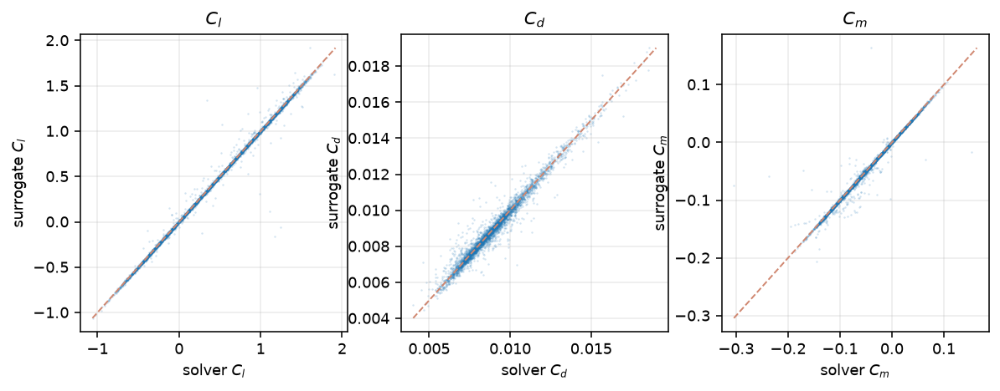
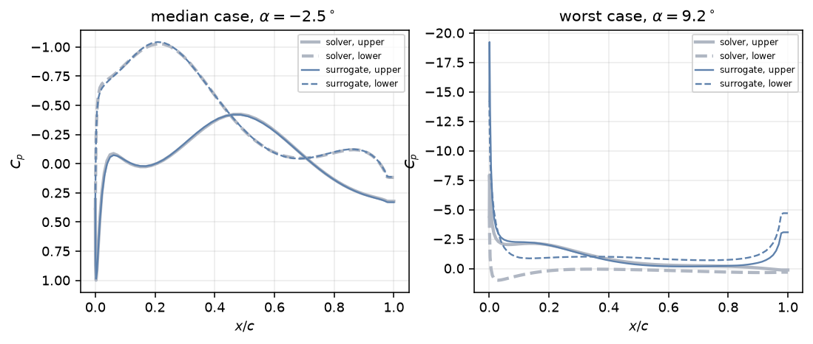
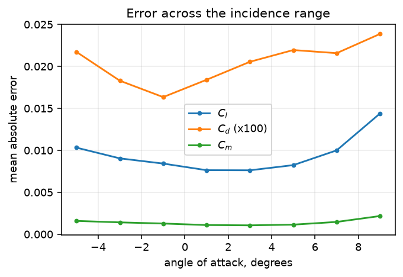

# Surrogate accuracy

Measured on the held-out test split: 6720 rows across
840 sections the model has never seen at any incidence. Every
figure here is regenerated by `uv run python -m tools.train.accuracy`.

The comparison is against this project's own solver, whose accuracy against reality is a separate
question answered in [`solver-validation.md`](solver-validation.md). **Both sets of error stack.** A
drag figure in the app carries the surrogate's error on top of the solver's three to ten per cent
bias against published data.

## Force and moment coefficients

| output       | target range       | mean absolute error | rms error | worst  | R-squared |
| ------------ | ------------------ | ------------------- | --------- | ------ | --------- |
| `cl`         | -1.0525 to +1.9033 | 0.00947             | 0.03810   | 1.3335 | 0.9957    |
| `cd`         | +0.0040 to +0.0186 | 0.00020             | 0.00033   | 0.0034 | 0.9685    |
| `cm_quarter` | -0.3042 to +0.1540 | 0.00141             | 0.00656   | 0.2299 | 0.9819    |

Drag is measured on the 4433 test rows whose viscous march converged; the others
have no drag to compare against.

## Pressure distribution

Across all 128 stations and every test row, the rms error in pressure coefficient is
**0.0552**. The worst single station is `cp_000` at
0.2106 — the stations nearest the leading edge are hardest, which is where the
gradient is steepest and where the solver itself is least reliable.

## Velocity field coefficients

The 32 modal coefficients are predicted with a relative error of
**6.02 %** in aggregate. What that means for the field a viewer actually sees is
in [`dataset.md`](dataset.md): the basis itself reconstructs to 1.14 % of the freestream away from
the section and 17.7 % in the band around it, and the surrogate's error adds to that.

## Error across the design space

| incidence | rows | mean absolute `cl` error | converged rows | mean absolute `cd` error |
| --------- | ---- | ------------------------ | -------------- | ------------------------ |
| -6 to -4  | 840  | 0.01033                  | 527            | 0.000217                 |
| -4 to -2  | 840  | 0.00905                  | 641            | 0.000183                 |
| -2 to +0  | 840  | 0.00843                  | 717            | 0.000164                 |
| +0 to +2  | 840  | 0.00764                  | 734            | 0.000184                 |
| +2 to +4  | 840  | 0.00763                  | 675            | 0.000206                 |
| +4 to +6  | 840  | 0.00825                  | 553            | 0.000220                 |
| +6 to +8  | 840  | 0.01001                  | 394            | 0.000216                 |
| +8 to +10 | 840  | 0.01440                  | 192            | 0.000239                 |

## Where this breaks

1. **Beyond the trained range.** The model saw incidence from -6 to +10 degrees and CST weights
   inside the bounds in [`DATASET-SCHEMA.md`](DATASET-SCHEMA.md). The app clamps every control to
   those bounds and warns when a design leaves them; outside, the prediction is extrapolation and
   nothing here applies to it.
2. **Near the edges of the incidence range**, where converged training rows thin out — 60 % of rows
   at -6 to -4 degrees and 15 % at +10. The table above shows what that costs.
3. **Drag, more than anything else.** It is the only output that needs a converged viscous march, so
   it is trained on 62 % of the rows, and it inherits the solver's own drag bias on top.
4. **Close to the surface in the velocity field**, where the reduced-order basis is weakest.
5. **The solver's own limits**, all of them, unchanged: two-dimensional, incompressible, one
   Reynolds number, no separation, no stall.

## The model

|               |                                                                            |
| ------------- | -------------------------------------------------------------------------- |
| Parameters    | 177,059                                                                    |
| Artifact      | ONNX, 0.71 MB                                                              |
| Training rows | 53 760                                                                     |
| Epochs        | 400, best at 389                                                           |
| Training time | 93 s on a CPU                                                              |
| Loss          | Huber on normalised outputs, group-weighted, drag masked to converged rows |
