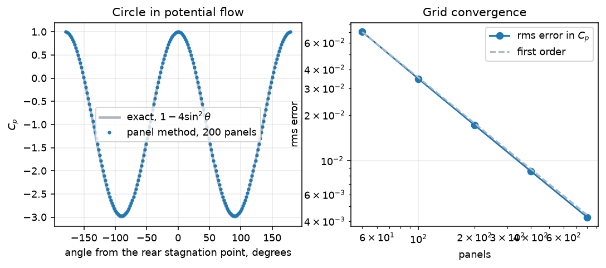
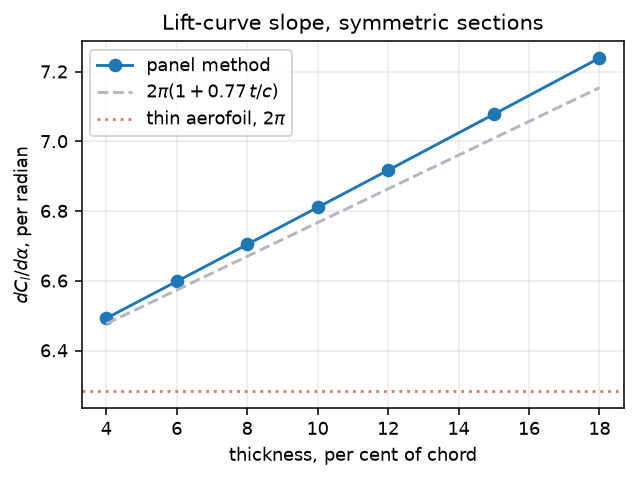
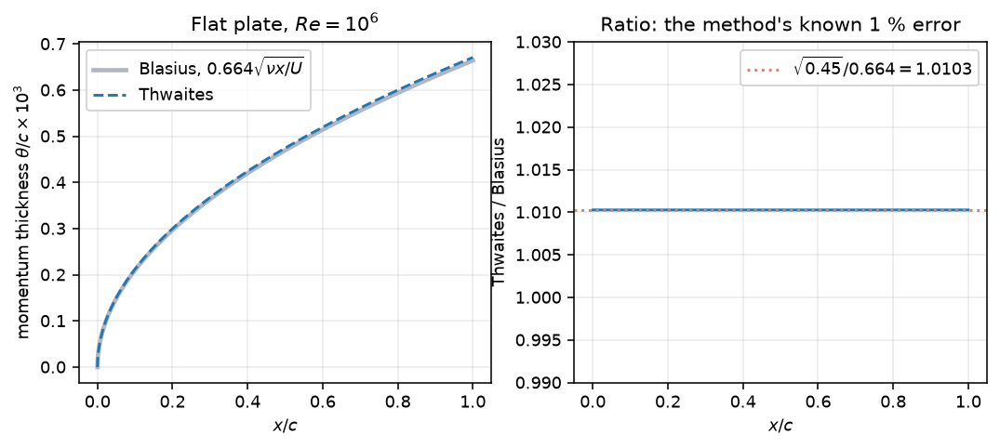
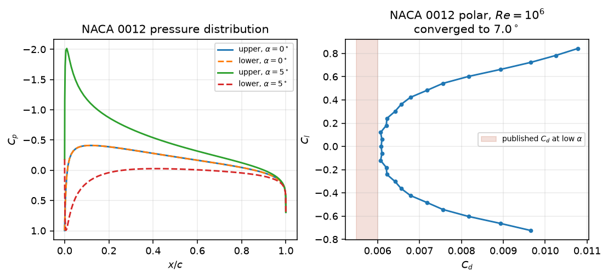
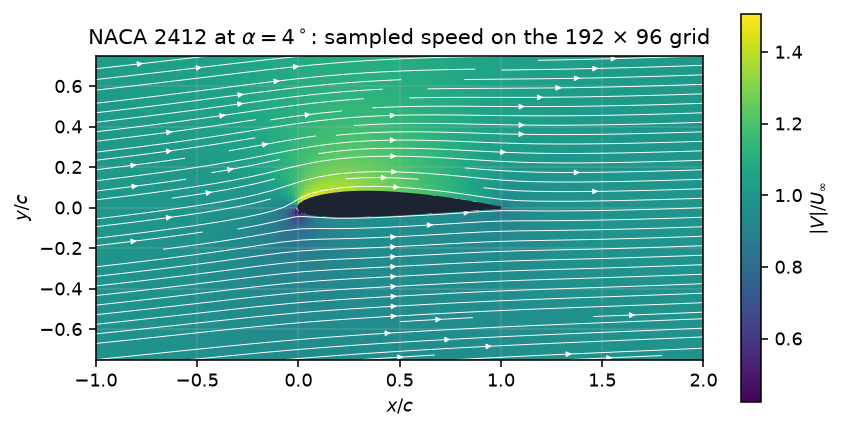

# Reference solver: what it is, what it gets right, where it breaks

The surrogate is only as good as the data behind it, so this document states exactly what the
reference solver can and cannot do. Every number here comes from
`uv run pytest tools/solver` and `uv run python -m tools.solver.make_validation_figures`, both
reproducible from a clean clone.

## The method

| Stage      | Method                                                                    | Module                           |
| ---------- | ------------------------------------------------------------------------- | -------------------------------- |
| Inviscid   | Linear-strength vortex panels, continuous nodal strength, Kutta condition | `tools/solver/panel.py`          |
| Laminar    | Thwaites' one-parameter integral method                                   | `tools/solver/boundary_layer.py` |
| Transition | Michel's criterion, or laminar separation, whichever comes first          | `tools/solver/boundary_layer.py` |
| Turbulent  | Head's entrainment method with Ludwieg-Tillmann skin friction             | `tools/solver/boundary_layer.py` |
| Drag       | Squire-Young at 98 % of chord, summed over both surfaces                  | `tools/solver/boundary_layer.py` |
| Field      | Closed-form panel velocity integrals on the schema grid                   | `tools/solver/field.py`          |

Two dimensional, incompressible, steady. Reynolds number one million throughout the dataset.

## Verification

Each check below has truth that can be derived rather than looked up; ADR-014 explains why no
reference tables are bundled.

### The exact circle solution



A circle in potential flow has `Cp = 1 - 4 sin^2(theta)` everywhere, no lift and no moment. The
panel method reproduces it with an rms error of 3.46e-2 at 100 panels, 1.72e-2 at 200 and
8.53e-3 at 400 — first-order convergence, which is what placing control points on panel chords
rather than on the circle predicts. Lift and moment come out at 1e-13.

### Thin-aerofoil theory



| Section   | `dCl/dalpha` per radian | Against `2*pi` | Against `2*pi (1 + 0.77 t/c)` |
| --------- | ----------------------- | -------------- | ----------------------------- |
| NACA 0004 | 6.4925                  | +3.3 %         | +0.2 %                        |
| NACA 0006 | 6.5983                  | +5.0 %         | +0.4 %                        |
| NACA 0008 | 6.7043                  | +6.7 %         | +0.5 %                        |
| NACA 0012 | 6.9172                  | +10.1 %        | +0.8 %                        |
| NACA 0018 | 7.2392                  | +15.2 %        | +1.2 %                        |

The departure from `2*pi` is the physical thickness effect, not an error: against the classical
thickness correction the agreement is better than 1.2 % across the range. A symmetric section
gives `Cl = 0` and `Cm = 0` at zero incidence to 1e-6, and `Cl / sin(alpha)` is constant to nine
digits, which is exact for this formulation.

### Internal consistency

Lift is computed twice, once from the circulation through Kutta-Joukowski and once by
integrating the surface pressure. At 320 panels the two agree within 0.3 %, and the gap halves
every time the panel count doubles. The velocity field is checked independently: a
counter-clockwise line integral around a rectangle three chords on a side returns `-cl/2` to one
part in a thousand, and the induced velocity decays as exactly `1/r`, matching the point-vortex
limit `Gamma / (2 pi r)` within 1 % at a thousand chords.

### Thwaites against Blasius



On a zero-pressure-gradient flat plate, Thwaites' method gives
`theta = sqrt(0.45) * sqrt(nu x / U)` against Blasius' `0.664 * sqrt(nu x / U)`. The ratio is
1.0103 at every station, which is this method's known accuracy — **about one per cent of error
is present on the laminar side before anything else is considered**. Skin friction agrees within
2 %, and laminar drag scales as `Re**-0.5` to within 1 %.

## Comparison with experiment



NACA 0012 at Reynolds one million, 320 panels, free transition:

| alpha | `Cl`              | `Cd`    | `Cd` friction | `Cd` pressure | transition, upper | transition, lower |
| ----- | ----------------- | ------- | ------------- | ------------- | ----------------- | ----------------- |
| -4    | -0.4826           | 0.00728 | 0.00486       | 0.00241       | 0.806             | 0.269             |
| -2    | -0.2415           | 0.00636 | 0.00469       | 0.00167       | 0.687             | 0.436             |
| 0     | 0.0000            | 0.00619 | 0.00475       | 0.00144       | 0.564             | 0.554             |
| +2    | +0.2415           | 0.00636 | 0.00469       | 0.00167       | 0.436             | 0.687             |
| +4    | +0.4826           | 0.00728 | 0.00486       | 0.00241       | 0.269             | 0.806             |
| +6    | +0.7232           | 0.00991 | 0.00559       | 0.00432       | 0.052             | 0.850             |
| +7    | +0.8432           | 0.01098 | 0.00573       | 0.00525       | 0.026             | 0.870             |
| +8    | — not converged — |         |               |               | 0.017             | 0.883             |

Published profile drag for this section at this Reynolds number with free transition is about
0.0055 to 0.0060. The solver gives 0.0062 at zero incidence, roughly **3 to 10 per cent high**.
Momentum thickness at the trailing edge is 0.00226 and the shape factor 1.66, both textbook
values for an attached turbulent trailing edge.

Lift is inviscid, so it carries no viscous decambering and is a few per cent high at moderate
incidence. The quarter-chord moment shows the same bias and it grows with camber:

| Section   | `Cl` at 0 deg | `Cm` at 0 deg | Published `Cm` | `Cd` at 0 deg | Converges to |
| --------- | ------------- | ------------- | -------------- | ------------- | ------------ |
| NACA 0012 | 0.0000        | -0.0000       | 0.000          | 0.00619       | +7.0 deg     |
| NACA 2412 | +0.2596       | -0.0553       | about -0.053   | 0.00654       | +6.5 deg     |
| NACA 4412 | +0.5182       | -0.1104       | about -0.093   | 0.00737       | +4.5 deg     |

NACA 4412's moment is 19 % too nose-down. That is the expected signature of an inviscid lift
calculation on a strongly cambered section: the real boundary layer thickens over the rear upper
surface and decambers it, which an uncoupled method cannot represent.

## The velocity field



The field sampled on the 192 by 96 grid, which proper orthogonal decomposition reduces to the
mean plus 32 modes and the browser reconstructs from the surrogate's predicted coefficients.
Flow accelerates over the suction side, the leading-edge stagnation point sits below the nose at
positive incidence, and the streamlines carry upwash ahead of the section and downwash behind it.

## Where this breaks

Stated bluntly, because every one of these limits is inherited by the surrogate and must appear
in the app:

1. **No separated-flow model.** The viscous march stops converging between about 4.5 and 7
   degrees depending on camber. Those rows are published with
   `solver_status = "bl_not_converged"` and are excluded from training. There is no stall, no
   post-stall behaviour, and no maximum lift coefficient.
2. **Separation-induced transition is an assumption.** When the laminar layer separates before
   Michel's criterion fires, the march transitions there and continues turbulent, on the
   reasoning that a short bubble reattaches at this Reynolds number. No bubble length and no
   reattachment loss are modelled. Above roughly four degrees this mechanism, not Michel's
   criterion, is what sets transition — see the transition columns above.
3. **No viscous-inviscid coupling.** Lift and pressure are purely inviscid. Expect a few per cent
   of optimism in lift and more in the moment of a cambered section.
4. **The trailing edge is cut off at 98 % of chord.** At a sharp trailing edge the inviscid edge
   velocity collapses toward the rear stagnation point and the momentum equation diverges.
   Squire-Young is evaluated at the cut-off instead.
5. **One per cent from Thwaites alone**, before the turbulent side, the transition model or the
   drag formula contribute anything.
6. **No compressibility, no three-dimensional effects, one Reynolds number.**
7. **The drag split is indicative.** Squire-Young gives the total; the friction part is
   integrated from the marched `cf` and the pressure part is the remainder. The total is the
   trustworthy number.

## Reproducing this

```bash
uv sync
uv run pytest tools/solver                              # 89 checks
uv run python -m tools.solver.make_validation_figures   # regenerates every figure above
```
